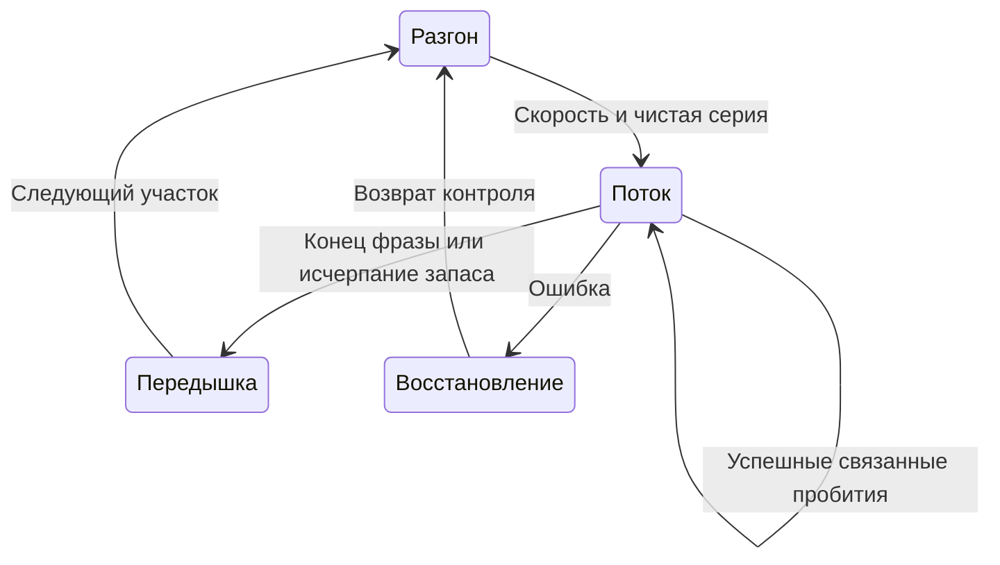

# SFB: аудит выпуска, сверхскорости и повторных прохождений

**Дата завершения:** 18 ноября 2026 года. **Проверенная версия:** `438a107`.
Проверки кода и браузера проводились 17–18 ноября. Основной акцент — сверхскоростная игра и метапрогрессия. Приложенный пользователем статический аудит использован как список гипотез, а не как доказательство неисправностей.

**Решение:** текущая версия подходит для ограниченного плейтеста. Для уверенного публичного выпуска прежде всего нужны читаемая сверхскорость, законченная петля повторного прохождения и устранение подтверждённых проблем сохранений. Общий рейтинг пока нельзя обещать как работающую, надёжную соревновательную функцию.

## 1. Что действительно проверено

| Проверка | Результат и границы вывода |
| --- | --- |
| Код | Игровой цикл, столкновения, управление, камера, комбо, BOOST, способности, генератор, прогрессия, магазин, задания, сохранения, рейтинг, графика и аудио |
| Модульные тесты | 602 теста в 114 файлах проходили на проверенной версии; повторный прогон выполнен при завершении аудита |
| Серверные тесты | Один интеграционный тест проходит; он включает несколько сценариев, но это не полноценный нагрузочный или античит-тест |
| ESLint и TypeScript | Проверены; результаты не заменяют браузерный и аппаратный плейтест |
| Сборка | Production-сборка успешно собиралась отдельно от `docs`; имена основных JS-артефактов совпали с поставляемой сборкой |
| Зависимости | `npm audit --omit=dev` при проверке не сообщил известных уязвимостей production-зависимостей; это не аудит безопасности собственного кода |
| Браузер | Headless Chromium, поставляемая production-сборка через Vite preview; окна 320×568, 390×844, 820×1180, 1366×768 |
| Игровые сценарии | Начало обычного забега, плазменная способность, высокая скорость, пауза, выход в меню и три повторных запуска |
| Изолированные воспроизведения | Перезапись прогресса двумя экземплярами профиля, потеря истории между вкладками, повтор сохранения после quota error, синтетический результат и обход ограничения IP-заголовком на локальном тестовом API |
| Опубликованный конфиг | `https://gdrclm.github.io/SFB/network-config.json` возвращал пустые адреса API и Supabase |

**Не проверено:** реальные Huawei/Safari/Android-устройства, длительный нагрев, часовой непрерывный забег, поведение десятков живых игроков, актуальная внешняя база Supabase/Render, права по договорам на музыку и арт. Цифры удержания, FPS настоящих телефонов и дохода неизвестны. Успешный запуск в Chromium не доказывает исправление прежнего сбоя MatePad.

Источники результатов: [сводка проверок](validation-evidence.txt), [модельные воспроизведения](models-evidence.json), [проверка локального API](rating-evidence.json), [скрипт моделей](probes/models.ts.txt), [скрипт API](probes/rating.mjs.txt). Эти скрипты используют только изолированную память и локальный тестовый сервер. Примеры сохранены как текст: для повторения снять конечное расширение `.txt` и выполнить команду из комментария; после проверки восстановить расширение. Они не входят в приложение или штатный тестовый набор.

## 2. Что уже есть и что нельзя записывать в отсутствующее

В SFB уже реализованы читаемость ближайшей платформы, относительные свайпы, ограничение горизонтального перемещения, несколько способностей, контекстное обучение, четыре глубинных мира, последовательности испытаний, повторное использование движка, музыка, вибрация и адаптивное качество. Разработка следующей версии может опираться на эти системы.

Пять старых замечаний о физике следует считать закрытыми на уровне текущей реализации и регрессионных тестов:

1. Рейтинговые 120 секунд теперь считает монотонный `ActiveRunClock`, отдельно от обрезаемого времени симуляции. Старый вывод «таймер напрямую зависит от количества fixed steps» уже не соответствует коду.
2. Непосредственное управление мышью/касанием проходит через ограниченное перемещение в `BallController`; старой безусловной телепортации по X больше нет.
3. `WorldStep` разрешает столкновение до начисления бонусов монет и до переработки объектов.
4. `CollisionResolver` продолжает sweep после удаления коллайдера; если обычный удар изменил траекторию, проверка корректно останавливается у контакта.
5. Пересечённые препятствия сохраняются до проверки удара; существуют Havok-регрессии на шаг через несколько платформ.

Источники: [WorldStep](https://github.com/gdrclm/SFB/blob/438a107/src/core/WorldStep.ts), [ActiveRunClock](https://github.com/gdrclm/SFB/blob/438a107/src/run/ActiveRunClock.ts), [CollisionResolver](https://github.com/gdrclm/SFB/blob/438a107/src/collision/CollisionResolver.ts), [StepRegression.test.ts](https://github.com/gdrclm/SFB/blob/438a107/src/collision/StepRegression.test.ts).

Эти исправления не доказывают равенство результатов на всех устройствах: различия поля зрения, управления и реальных задержек ещё требуют сравнительного теста.

## 3. Основные проблемы по приоритету

Обозначения: **P0** — блокирует выпуск конкретной обещанной функции; **P1** — исправить до публичной beta; **P2** — важная доработка; **P3** — последующее развитие. Геймдизайнерские предложения ниже не объявляются техническими P0.

| ID | Приоритет | Наблюдение | Статус |
| --- | --- | --- | --- |
| SPEED-01 | P1 | На сверхскорости отдаление камеры делает игровое содержимое миниатюрным | Код, расчёт и скриншот |
| SPEED-02 | P1 продукта | Рост скорости после 55 не повышает скоростной множитель очков; серия после 15 не открывает новый множитель | Подтверждено; влияние на мотивацию проверить |
| META-01 | P1 продукта | Магазин и повторяющиеся задания не образуют долгой структуры мастерства | Подтверждён состав систем; удержание не измерено |
| SAVE-01 | P1 | Два открытых экземпляра могут перезаписать покупки и историю друг друга | Воспроизведено |
| SAVE-02 | P1 | Повтор сохранения того же результата после quota error не пробует записать его заново | Воспроизведено |
| NET-01 | P0 онлайн-релиза | В опубликованном конфиге рейтинг не подключён | Подтверждено HTTP и интерфейсом |
| NET-02 | P0 призового рейтинга | Сервер принимает формально допустимый результат без доказательства прохождения | Воспроизведено на локальном Node API |
| NET-03 | P1 до включения рейтинга | Версия правил остаётся `demo-2026-10-21` после изменений баланса | Подтверждено |
| PERF-01 | P1 | Первый запуск дорогой; низкая графика не уменьшает набор загружаемых атласов | Наблюдение Chromium и код; реальные телефоны не измерены |
| WORLD-01 | P1 полного четырёхмирового релиза | Введение собственных поверхностей поздних миров и музыкальные состояния проработаны неравномерно | Подтверждено кодом |
| REL-01 | P1 | В репозитории нет проверяемого GitHub Actions-контура и сохраняемых browser E2E | Подтверждено составом репозитория; внешняя CI-система неизвестна |
| SAVE-03 | P2 | История и список зачисленных забегов растут без ограничения | Подтверждено |
| UX-01 | P2 | Магазин обещает удержание аннигиляции 2 с, фактически требуется 3 с | Подтверждено |
| UX-02 | P2 | Нет отдельной игровой настройки силы тряски/вспышек; используется системное reduced motion | Подтверждено; индивидуальную переносимость не измеряли |

## 4. Сверхскорость: чего именно не хватает

### 4.1. Сейчас не нулевой фундамент, а несколько несвязанных усилений

| Система | Текущее поведение | Значение для следующей версии |
| --- | --- | --- |
| BOOST | Серия из 6 ударов, улучшениями сокращается до 4; один заряд; скорость ×1,5 | Уже есть связь мастерства и разгона |
| Комбо | Пороги 3 / 6 / 10 / 15, максимум ×5 | После 15 можно продолжать рекорд серии, но нового множителя нет |
| Скоростной бонус | 1 / 1,25 / 1,5 / 2; максимум при 55 | Удар при 70, 150 и 300 с одинаковыми прочими условиями получает одинаковый скоростной коэффициент |
| BreakFlow | 6 лёгких последовательных ударов, промежуток не более 0,9 с; усиление на 3 с | Это основа краткого режима потока, а не отсутствие системы вообще |
| Плазма | Купленная способность: разгон и 30 с неуязвимости; одна активация за забег | Это облегчение прохождения; его стоит отличать от заработанного мастерством потока |
| Генератор | Учитывает скорость, дистанцию манёвра, фазу мира, последовательности и передышки | Не нужно переписывать генератор с нуля |
| Визуал/звук | След, ветер, деформация, свист, импульсы камеры, адаптивный темп музыки | Следует согласовать их с состоянием игры, а не бесконечно усиливать все сразу |

Источники: [ComboController:1](https://github.com/gdrclm/SFB/blob/438a107/src/combo/ComboController.ts#L1), [BreakFlow:4](https://github.com/gdrclm/SFB/blob/438a107/src/collision/BreakFlow.ts#L4), [BoostController](https://github.com/gdrclm/SFB/blob/438a107/src/boost/BoostController.ts), [PowerUpController](https://github.com/gdrclm/SFB/blob/438a107/src/powers/PowerUpController.ts).

В воспроизведении двадцатый обычный успешный удар при отношении прочности к скорости 0,5 дал 250 очков на скоростях 55, 70, 150 и 300. Это **не означает отсутствия пользы скорости**: игрок быстрее набирает глубину и может получать больше событий за время. Но отдельная награда за более высокий диапазон здесь заканчивается рано.

### 4.2. Главная подтверждённая проблема — масштаб

Камера увеличивает размер видимой области пропорционально квадратному корню скорости. Ограничения сверху в этой формуле нет. Для портретного поля 390 px и шара с базовым диаметром 1 мировой единицы расчёт установившегося размера до деформации и дополнительных FX даёт:

| Скорость | Диаметр базового тела на экране |
| --- | --- |
| 10 | 39 px |
| 70 | 14,7 px |
| 150 | 10,1 px |
| 183 | 9,1 px |
| 300 | 7,1 px |
| 600 | 5,0 px |

В браузере после плазменного разгона до примерно 183 герой, монеты и платформы действительно стали мелкими, а лучи и аура визуально доминировали. Поэтому дальнейшее усиление свечения само по себе проблему не решит.

[Обычная скорость](game-baseline.png) · [Плазма, около 183](game-plasma.png).

Источники: [CameraController:35](https://github.com/gdrclm/SFB/blob/438a107/src/camera/CameraController.ts#L35), [CameraController:151](https://github.com/gdrclm/SFB/blob/438a107/src/camera/CameraController.ts#L151), [конфигурация](https://github.com/gdrclm/SFB/blob/438a107/src/config/gameConfig.ts#L188).

Есть второй эффект: видимая дистанция растёт как √v, а пройденная за секунду — примерно как v. Поэтому время предварительного обзора при росте скорости сокращается. Расстановка уже компенсирует часть сложности расстояниями между рядами, но не гарантирует, что следующий выбор достаточно рано виден.

**Первый эксперимент:** ограничить дальнейшее отдаление и одновременно подготовить крупные скоростные группы с заранее видимыми входами. Проверять весь масштаб «герой — коллайдер — монета — проход». Простое увеличение только видимого шара создаст несоответствие столкновений; простое ограничение камеры сократит обзор. Эти изменения нельзя проверять по одному скриншоту отдельно от маршрута.

Начальные критерии для эксперимента: узнаваемый герой примерно 24–36 CSS px; крупный маршрут различим до необходимого манёвра; визуальное тело согласовано с коллайдером. Размеры — проектные цели, а не уже установленный баланс.

### 4.3. Предлагаемый режим потока

Задача: превратить накопленную скорость в короткий период управляемого могущества. Игрок сначала зарабатывает состояние, затем использует его на выразительном маршруте и решает, насколько рисковать дальше.

**Разгон.** Игрок выбирает доступные пробития, собирает монеты и заряжает BOOST. Существующие правила остаются узнаваемыми. Перед скоростным участком мир даёт короткую читаемую подготовку.

**Вход в поток.** В первом прототипе использовать существующий BreakFlow, а не добавлять вторую шкалу: достигнута достаточная скорость и выполнена серия лёгких быстрых ударов. Сначала измерить, насколько реально получить текущие 6 ударов с интервалами до 0,9 с на штатной трассе. Порог 70–90 — кандидат для теста, не окончательное правило.

**Поток.** Расширить текущие 3 с до тестового окна 8–12 с. Успехи продлевают его понемногу, с верхним пределом; пустота и безопасный отказ от серии не должны ощущаться как внезапный штраф. Привязать время к активному реальному времени, отдельно от ограничения physics catch-up. Нужны тесты паузы, SLOW, потери контекста и низкого FPS.

**Выход.** Запас заканчивается мягким переходом в участок восстановления. Ошибка завершает поток по понятным правилам жизни и скорости; нельзя одновременно добавлять новое наказание поверх уже существующей потери жизни, комбо и импульса. Улучшение «Инерционный корпус» должно сохранять свой смысл.

Первый прототип не должен давать полную неуязвимость: иначе он продублирует плазму и уберёт выбор. Опасные препятствия сохраняют значение. Для обычных лёгких материалов можно испытать цепной разлом 2–4 заранее связанных частей **в выбранной группе**, а не тотальную очистку экрана.

Правило против бесплатного наращивания серии: автоматические вторичные разломы не должны сами заряжать BOOST и рекурсивно продлевать поток. Основная награда начисляется за законченный участок или прямые действия игрока, с ограничением на повторные выплаты.

### 4.4. Какие решения должен принимать игрок

| Участок | Решение игрока | Что показывает мастерство |
| --- | --- | --- |
| Разрушительный каскад | Войти в нужную группу и удержать направление | Чистые последовательные пробития |
| Скоростная развилка | Выбрать крупный сектор заранее | Чтение маршрута, а не сравнение мелких чисел |
| Рискованная добыча | Уйти за богатой дугой монет или сохранить серию | Контроль и оценка риска |
| Выход из потока | Забрать гарантированную награду или продолжить трудную ветку | Осознанное продолжение, а не случайная смерть |

Сборка каждой фразы: видимый вход → 2–3 связанных действия → заметное завершение → короткая передышка. Скорость увеличивает расстояния и выразительность разрушения, а не бесконечно уменьшает допустимое время реакции.

В первом прототипе достаточно двух сильных рисунков: широкий извилистый каскад и развилка «серия / монеты». Новые типы платформ для этого не обязательны.

### 4.5. Как сообщать о состоянии без нового перегруженного HUD

- Вход: короткое изменение позы, плотный звуковой акцент и вспышка названия на 0,5–0,8 с.
- Поддержание: характер ауры, ритм разрушений и насыщенность следа. Число комбо остаётся коротким существующим уведомлением.
- Близкий выход: спад плотности звука/свечения, не дополнительный абзац текста.
- Завершение: одна награда и краткий акцент; детали — в результатах.

Приоритет изображения: опасность и проход → герой → результат удара → награда → декоративные FX. На высокой скорости уменьшать второстепенный шум можно независимо от мощности телефона.

Музыка уже меняет темп с сохранением высоты нот. Следующим шагом лучше испытать один дополнительный ритмический слой потока и ясный акцент выхода. Синхронные стемы потребуют отдельной подготовки аудио; нельзя обещать точное музыкальное сведение простым наложением произвольных MP3.

### 4.6. Проверка гипотезы

Сравнить текущую версию и прототип на одинаковых исходных условиях. Не переносить результаты разных правил в одну рейтинговую версию.

Измерять: время до первого потока; долю игроков, вошедших в него; длительность управляемого потока; причины выхода; осознанные смены ветки; понятность смерти по записи; желание сразу повторить. Отдельно спросить, где игрок чувствовал силу, а где лишь потерял возможность разглядеть препятствия.

Цель первого теста: участник без пояснений различает обычное падение и поток, понимает причину его получения и сохраняет управление. «Больше частиц» не считается доказательством успеха.

## 5. Метапрогрессия: причина следующей попытки

### 5.1. Что ограничивает текущую систему

В магазине 18 позиций, включая бесплатные базовые варианты. Полная покупка всех уровней и платных предметов требует **6 445 монет** по текущим ценам. Из них **6 065 — способности и функциональные улучшения**, **380 — косметика**. Около 94% общей стоимости приходится на усиление. Это структура цен, а не измерение того, на что игроки действительно тратят деньги.

В заданиях пять шаблонов; после достижения максимального `round=5` требования больше не растут. Каждое выполнение даёт 10 монет. После завершения выбранное задание снимается — это соответствует запрошенному поведению списка, но новый мотив для следующего забега автоматически не формируется.

Источники: [PlayerProfile:17](https://github.com/gdrclm/SFB/blob/438a107/src/shop/PlayerProfile.ts#L17), [Missions:1](https://github.com/gdrclm/SFB/blob/438a107/src/run/Missions.ts#L1), [MissionBoard](https://github.com/gdrclm/SFB/blob/438a107/src/run/MissionBoard.ts), [воспроизводимый расчёт](models-evidence.json).

Сейчас возможен переход «купил облегчение → увидел более далёкое место», но слабее оформлен переход «научился новому → получил узнаваемое доказательство мастерства → захотел попробовать другой стиль». После заполнения магазина остаются личный рекорд и повторяющиеся задания.

Это не доказывает плохое удержание: D1/D7 и поведение игроков не измерены. Но долгосрочная система целей в коде действительно ограничена.

### 5.2. Рекомендую три опоры вместо большого дерева характеристик

| Опора | Что сохраняется | Почему игрок вернётся |
| --- | --- | --- |
| Мастерство миров | Три понятные отметки на каждый мир | Освоить знакомое пространство лучше |
| Контракты на стиль | Выбранная цель на 1–3 попытки | Пройти тем же набором механик другим способом |
| Коллекция выразительных наград | Скины, следы, входы в поток, косметические финальные анимации | Получить видимое отличие и собрать комплект |

Показывать эту структуру в отдельном окне заданий/коллекции. В главном меню достаточно одного краткого следующего ориентира. Во время падения новый постоянный текст не нужен.

### 5.3. Отметки мастерства миров

Первый вариант — 3 ступени на мир:

1. **Открыл:** дошёл до мира обычным забегом. Показывает доступность и даёт небольшую награду.
2. **Освоил:** выполнил характерное испытание мира.
3. **Мастер:** закончил сложную связанную фразу на высокой скорости по фиксированным условиям.

Примеры заданий для теста:

| Мир | «Освоил» | «Мастер» |
| --- | --- | --- |
| Небо | Закончить каскад без потери жизни | Удержать чистую скоростную серию на двух связанных ветках |
| Кристаллы | Пройти испытание механизмов с осознанными обходами | Пройти связку механизмов и разрушений с сохранением потока |
| Лава | Испытание уникальной механики лавы после её разработки | Кульминация этой механики, а не только большая глубина |
| Бездна | Испытание позднего пространственного правила | Длинная скоростная комбинация с выбором маршрута |

Нельзя выдавать отметку мастерства только за активацию 30-секундной плазмы. Для испытаний заранее определять допустимые способности; обычные купленные облегчения сохраняются в свободном режиме. Это разделение условий, а не отмена ценности покупок.

После первого честного открытия мира можно открыть тренировочный вход туда. Такой режим следует явно отделить от рекордного старта с нуля и ограничить повторную добычу наград, иначе ранние миры станут ненужными, а отметки — фармом.

### 5.4. Контракты должны менять способ игры

Начать с 6–8 осмысленных вариантов, не с десятков новых счётчиков:

- Войти в поток в кристальном мире и завершить одну скоростную фразу.
- Собрать богатую монетную дугу и пройти её последнюю опасную развилку без потери жизни.
- Пройти заданную фразу без BOOST.
- Провести чистую цепочку разломов выбранного семейства материалов.
- Закончить отмеченный участок с выбранной способностью.
- После первой ошибки восстановить серию и закончить следующий каскад.
- Пройти фиксированное испытание мира на стандартизированных условиях.

Контракт привязывается к версии правил и фактам прохождения фраз, а не только к количеству сломанных объектов. За один контракт — одна подтверждённая выплата, включая перезапуск страницы и повторную доставку события.

При выборе показывать действие, награду и примерную длину цели. Не выводить одновременно несколько конкурирующих заданий на игровом поле.

### 5.5. Экран завершения должен продавать следующую попытку

Сейчас он в основном подводит числовой итог. Добавить **один** следующий мотив в зависимости от главного события:

> «Кристаллы: освоено 2 из 3. Следующая цель — чистый скоростной каскад».

Или:

> «До мятного комплекта осталось 35 монет».

Или:

> «Лучший поток: 8,4 с. Личный рекорд — 9,1 с».

Выбирается одно сообщение, а не все три. «Ещё раз» остаётся главным действием; подробные результаты и коллекция доступны отдельно. После завершения контракта предложить следующий вариант, но не назначать его незаметно вместо выбора игрока.

### 5.6. Экономика и покупки

Не менять цены по одному впечатлению. Собрать распределение монет и наград за законченный/неудачный забег у новичка, среднего и опытного игрока. Учитывать, что монеты одновременно ускоряют шар, пополняют энергию и оплачивают покупки: их расположение влияет и на баланс, и на экономику.

Например, одна плазма за 2 500 монет потребует 50 попыток при среднем чистом доходе 50 монет или 25 при доходе 100. Это только арифметические сценарии: текущий средний доход неизвестен. Прибавка наград контрактов также меняет результат.

Цели первого балансового теста: ранняя заметная награда за несколько удачных попыток, промежуточная цель между дешёвым скином и дорогой способностью, сохраняющаяся ценность мастерства после покупки усилений. Не вводить обязательный престиж с обнулением купленных предметов: он конфликтует с ценностью коллекции и усложняет сохранения.

Если реальный донат входит в выпуск, нынешний локальный магазин недостаточен: требуются платёжная интеграция, серверное подтверждение прав, восстановление покупки и обработка возврата. Сейчас цены выражены в игровых монетах. Продажа удобства не должна означать, что технически непроходимая базовая трасса считается нормальным балансом.

### 5.7. Минимальный объём метапрогрессии для следующего плейтеста

- 6 отметок мастерства для первых двух миров.
- 6–8 контрактов с разными способами прохождения.
- 2–3 набора косметических наград с заметным различием в игре.
- Один краткий следующий ориентир после забега.
- Тренировка уже открытого мира на отдельных условиях.

Сезоны, кланы, battle pass, большое дерево талантов и принудительный престиж пока не нужны для проверки этой петли.

## 6. Подтверждённые технические проблемы

### SAVE-01. Конкурирующие вкладки теряют изменения

`PlayerProfile` и `RunHistory` читают снимок при создании, затем записывают его целиком. Согласование ревизий между вкладками отсутствует.

Воспроизведение: два профиля читают баланс 100. Первый покупает энергию за 25, второй из старого снимка — золотой шар за 50. Обе операции возвращают успех. После повторного чтения энергия снова уровня 0, золотой шар куплен, баланс 50. Покупка первой вкладки потеряна. Два экземпляра истории, сохранившие `a` и `b`, оставили в хранилище только `b`.

Источники: [PlayerProfile:151](https://github.com/gdrclm/SFB/blob/438a107/src/shop/PlayerProfile.ts#L151), [RunHistory:63](https://github.com/gdrclm/SFB/blob/438a107/src/run/RunHistory.ts#L63).

**Исправление:** транзакционное хранилище с ревизией и сериализацией операций; предпочтительно IndexedDB. Для временного решения — явно один активный записывающий экземпляр, синхронизация изменений и повторное чтение перед операцией. Один `storage` event без защиты read-modify-write не делает покупку атомарной.

**Приёмка:** параллельные покупки, окончания забегов и награды в двух вкладках не теряют и не дублируют ни предметы, ни монеты, ни записи.

### SAVE-02. Неудачное сохранение нельзя повторить тем же методом

`RunHistory.save` добавляет результат в память до записи. При quota error он остаётся в памяти. Повторный вызов для того же ID сразу возвращается, не пытаясь записать данные после восстановления места. Результат может попасть в диск при следующем новом забеге, но этот обходной эффект не является надёжной повторной записью.

**Исправление:** отделить наличие результата в памяти от подтверждённой долговечной записи; иметь dirty/retry-состояние. Обработать сбой между записью истории и зачислением монет как отдельную восстанавливаемую операцию.

**Приёмка:** искусственный отказ, освобождение места и повтор сохранения без нового забега сохраняют тот же результат ровно один раз.

### SAVE-03. Рост истории и сохранность при очистке

`RunHistory` хранит все записи, `PlayerProfile` — все ID зачисленных забегов. Ограничения нет. Локальные покупки также не переносятся между устройствами.

**Исправление:** отдельные агрегированные рекорды, ограниченная история, ограниченный журнал зачислений с безопасным правилом уплотнения, версия схемы и экспорт/восстановление. Нельзя просто обрезать `creditedRuns`, оставив старую историю: повторное зачисление старых забегов даст лишние монеты.

Для выпуска с оплатой реальными деньгами локальный профиль не может быть единственным подтверждением права на покупку.

### NET-01–03. Рейтинг и правила

Публичный JSON не содержит рабочего адреса. Браузер показывает «Общий рейтинг ещё не подключён». Сетевая архитектура написана, но опубликованная игра сейчас не предоставляет обещанный общий рейтинг.

В локальном API был зарегистрирован изолированный тестовый игрок, создана попытка, сдвинут только внедрённый серверный тестовый таймер и отправлены придуманные показатели. Игра не запускалась. API ответил `accepted: true`, записав **122 500 000 очков**. Это подтверждает доверие к согласованным данным клиента. Проверка владельца и пересчёт арифметики полезны, но не доказывают прохождение.

Источник: [rating.mjs:50](https://github.com/gdrclm/SFB/blob/438a107/server/rating.mjs#L50). Сам проект уже честно описывает этот предел в [ONLINE.md](https://github.com/gdrclm/SFB/blob/438a107/documentation/ONLINE.md).

Для небольшого публичного демо допустимо явно экспериментальное соревнование с модерацией и пределами правдоподобия. Для призов/надёжного рейтинга нужны версия детерминированных правил, проверяемые события/ввод и серверная проверка, либо иной выбранный уровень серверной авторитетности. Один новый верхний предел очков проблему не закрывает.

`demo-2026-10-21` зафиксирован в клиенте, JSON и сервере. Перед включением рейтинга следует выпустить новую версию правил, отделив старые результаты; дальнейшие изменения скорости, наград, трассы и доступных способностей не должны незаметно смешивать сравнения.

Трасса и доступная ширина расширяются вместе с камерой и соотношением сторон. Равенство возможностей мыши, свайпа, планшета и широкого монитора не доказано. Для рейтинга выбрать фиксированное логическое поле либо явно раздельные условия и проверить один набор сценариев на всех профилях.

### NET-04. Хранение и ограничение запросов

`render.yaml` выбирает бесплатный сервис, а Node пишет SQLite в `.runtime`. Без постоянного хранилища такой вариант нельзя представлять как долговечный банк рекордов. Текущая внешняя конфигурация Render не проверялась; документация проекта уже предупреждает об этом риске.

При локальной проверке после ограничения запросов для одного `cf-connecting-ip` смена произвольного значения заголовка позволила получить новый лимит. На реальном хосте результат зависит от того, перезаписывает ли доверенный прокси этот заголовок. Нужно определить цепочку доверенных прокси, а не безусловно считать переданный клиентом заголовок достоверным IP.

Источники: [render.yaml](https://github.com/gdrclm/SFB/blob/438a107/render.yaml), [server/index.mjs](https://github.com/gdrclm/SFB/blob/438a107/server/index.mjs), [rating.mjs:80](https://github.com/gdrclm/SFB/blob/438a107/server/rating.mjs#L80).

### PERF-01. Чёткость и память — разные бюджеты

В браузерном сценарии первый старт с новой страницы до готовности забега занял 8,38 с. Это локальный Chromium с программным GPU, после предшествующих проверок интерфейса; это **не** измерение холодной сети или настоящего телефона.

На ранней сцене инструментирование наблюдало 22 живые текстуры с суммарной площадью около 66,3 MiB в пересчёте на RGBA8. Это оценка базовых текстурных поверхностей, а не замер всей VRAM: буферы, накладные расходы, форматы и возможные дополнительные уровни сюда не сведены.

После трёх повторных запусков число и оценка размера текстур оставались прежними. JS heap после принудительного GC вышел примерно на 13,1 MB; явного продолжающегося роста за этот короткий тест не обнаружено. Это хороший признак повторного использования ресурсов, но не доказательство отсутствия утечки в часовом забеге.

`SurfaceSkin` создаёт все анимационные атласы семейства, а старт ждёт наборы текстур. Низкое качество снижает разрешение framebuffer и часть эффектов, но не даёт отдельного облегчённого набора этих атласов. Поэтому низкая графика не обязана устранять сбой, связанный с текстурной памятью/драйвером.

Источники: [SurfaceSkin:128](https://github.com/gdrclm/SFB/blob/438a107/src/platform/SurfaceSkin.ts#L128), [PlatformSprites:74](https://github.com/gdrclm/SFB/blob/438a107/src/platform/PlatformSprites.ts#L74), [AdaptiveQuality](https://github.com/gdrclm/SFB/blob/438a107/src/rendering/AdaptiveQuality.ts), [GameSceneSession](https://github.com/gdrclm/SFB/blob/438a107/src/scene/GameSceneSession.ts).

**Приоритет:** загрузка семейств по миру, отдельный облегчённый набор текстур, бюджет перехода между мирами, измерение компиляции шейдеров и первого старта на устройстве. Затем — точечная оптимизация наиболее дорогих draw calls и прозрачных эффектов.

### UX-01. Аннигиляция описана противоречиво

Карточка магазина обещает удержание 2 с, `FULL_HOLD_MS` равен 3000; справочник и активная кнопка говорят о 3 с. В исходном запросе пользователя было 2+ секунды. Нужно выбрать одно значение и использовать общий источник длительности для текста и поведения.

Источники: [PlayerProfile:21](https://github.com/gdrclm/SFB/blob/438a107/src/shop/PlayerProfile.ts#L21), [PowerUpView:2](https://github.com/gdrclm/SFB/blob/438a107/src/powers/PowerUpView.ts#L2).

## 7. Миры, обучение, интерфейс и звук

Границы уже соответствуют 0 / 500 / 3 000 / 12 000 м. Внутренние фазы и восстановительные фразы существуют. Поэтому претензия «есть только случайные ряды без композиции» слишком сильная. Вопрос следующего теста — замечает ли эту композицию игрок.

В `SurfaceIntroduction` собственный словарь введения поверхностей есть для неба и кристаллов; для поздних миров возвращаются неопределённые поверхности. Это **не** отсутствие декораций, цветокоррекции или всех механик Lava/Abyss. Это отсутствие эквивалентного механизма авторского ввода собственных поверхностей.

Для полноценного четырёхмирового выпуска выбрать по одному сильному отличительному правилу Lava и Abyss, затем освоение и кульминацию этого правила. Не добавлять по восемь новых платформ до проверки первых двух миров. Для выпуска демо можно честно ограничить заявленный объём и не объявлять всю позднюю игру готовой.

Музыкальный контроллер знает Sky/Crystal и Miny; при уходе из кристаллов `crystalBlend` возвращается к нулю и система возвращается к небесному треку. Lava/Abyss требуют универсального состояния музыкальной зоны, если включаются в полноценный выпуск.

В проверенных окнах меню не имело горизонтального переполнения, кнопка «Играть» была доступна. На 320×568 настройки и магазин прокручиваются; это не само по себе ошибка, но пункты должны оставаться достижимыми одной рукой. Новый главный экран заметно спокойнее старых скриншотов — переписывать его целиком снова оснований нет.

[Главное меню 390](menu-390.png) · [320](menu-320.png) · [Планшет](menu-820.png) · [ПК](menu-1366.png) · [Магазин](shop.png) · [Настройки](game-settings.png) · [Пауза](pause.png).

Обучение и справочник разделены, контекстные стрелки не должны блокировать игру. Следующий шаг — наблюдать 8–12 новых участников без устных подсказок: движение, первая монета, первый доступный BOOST, ошибка и восстановление. Завершение обучения не равно пониманию. Другие способности лучше проверять по мере появления реального выбора.

Для доступности добавить явную настройку интенсивности тряски/вспышек, сохранив эффектный режим по умолчанию. Системное reduced motion уже используется, но не заменяет удобный выбор внутри игры. Цвета пробиваемости дополнены другими признаками; отдельно проверить их узнаваемость при уменьшении масштаба, на солнце и при сниженной цветоразличимости.

## 8. Эксплуатация и выпуск

В репозитории отсутствует GitHub Actions workflow. Это не доказывает отсутствие внешних проверок, но текущий репозиторий не обеспечивает обязательное прохождение тестов перед публикацией.

Минимальная последовательность: `npm ci` → типы приложения и конфигурации → lint → 602 модульных теста → server tests → production build → browser smoke. Проверять результат именно собранной версии, а не только dev server.

Сохраняемые browser smoke должны покрывать: согласие на музыку, обычный старт, повторный старт, паузу/выход, покупку/выбор способности, завершение с начислением монет, перезагрузку, отказ хранилища и потерю WebGL-контекста. SQL/RLS-тесты выполнять отдельно в тестовом Supabase; в этом аудите они не запускались.

Нужны номер сборки и версия правил, история изменений, воспроизводимый артефакт и известный способ отката. Source maps сами по себе не являются уязвимостью; наличие большого `GameApplication` само по себе тоже не блокер. Разделять его стоит постепенно вокруг жизненного цикла забега, результатов, обучения и UI после добавления интеграционных проверок.

Перед коммерческим выпуском составить реестр прав на композиции, записи, аранжировки, изображения и модели. Отсутствие LICENSE или договоров в репозитории не доказывает нарушения; этот аудит не может подтвердить права по приватным соглашениям. Для онлайн-профиля нужны понятные правила публичности имени/результата, хранения и удаления аккаунта.

Установку PWA и offline-режим рассматривать по выбранному формату выпуска, а не как обязательное условие обычной браузерной демоверсии. Реальные платежи и перенос покупок — отдельный выпускной контур, если их обещают игрокам.

## 9. Порядок следующей разработки

| Этап | Конкретный результат | Проверка выхода |
| --- | --- | --- |
| A. Читаемая скорость | Испытательный масштаб камеры и скоростные группы | На 70 / 150 / 300 видны герой, следующий выбор и причина ошибки |
| B. Один режим потока | Вход по мастерству, понятное поддержание/завершение, две фразы | Новый игрок отличает его от обычного падения и от плазмы |
| C. Повторная попытка | 6 отметок миров, 6–8 контрактов, первые коллекционные наборы | После результата есть одна понятная причина повторить; HUD не разрастается |
| D. Надёжность | Исправление SAVE-01/02, журнал выплат, лимит истории, CI | Вкладки, quota error, перезапуск и повтор события не теряют/дублируют награды |
| E. Проверяемая beta | Матрица устройств, метрики, выбранный объём миров | Реальные мобильные сессии проходят критерии ниже |
| F. Онлайн-выпуск | Постоянный backend, новая версия правил, выбранная модель защиты | Рейтинг доступен извне, восстанавливается из копии и не обещает неподтверждённый античит |

Это порядок результатов, не календарная оценка. Для планирования в днях нужны реальные скорости производства арта, аудио и исправлений на устройствах. Надёжность сохранений и подготовку CI не стоит откладывать до окончания всего контента.

## 10. Критерии приёмки релизного кандидата

Все числовые цели ниже предлагаются для проверки; они не являются уже достигнутыми метриками.

| Направление | Условие допуска |
| --- | --- |
| Основной цикл | Участник без объяснений понимает движение, пробитие и BOOST; по записи может объяснить ошибку |
| Сверхскорость | Проверены 70 / 150 / 300 и плазма; герой не превращается в точку, входы в маршруты видны до манёвра |
| Поток | Получается штатным мастерством; вторичные разрушения не создают бесконечный заряд и выплаты |
| Метапрогрессия | Несколько различающихся целей и видимых наград; причина новой попытки понятна после покупки основных улучшений |
| Производительность | Утверждены конкретные модели/браузеры; целевой минимум 30 FPS на поддерживаемом слабом устройстве и 60 на основном профиле; отдельно контролируются длинные кадры и нагрев |
| Первый старт | Измерен cold/warm start на настоящем устройстве и заданной сети; загрузка обозначена ясно; отказ ассета даёт повтор/выход |
| Повтор | Повторный забег без полной переинициализации; целевое время до управления измеряется отдельно от загрузки страницы |
| Память | 20 повторов, проход переходов миров и 20–30 минут игры без устойчивого роста после очистки; texture budget измерен отдельно от framebuffer |
| MatePad | Именно проблемный планшет: запуск, 10 минут, потеря/восстановление контекста, выход в настройки, новая попытка; сцена не остаётся пустой |
| Сохранения | Reload, две вкладки, заполненное/недоступное хранилище, повтор награды и сбой между записями проходят без потери подтверждённого прогресса |
| Рейтинг | Версия правил видна и изолирована; сервер доступен; выбран и честно описан уровень достоверности результатов |
| Артефакт | Чистая установка зависимостей воспроизводит сборку; CI и browser smoke проходят; предыдущая версия доступна для отката |
| Контент | Обещанный объём миров завершён; права на используемые материалы подтверждены владельцем проекта |

Минимальная аппаратная матрица: проблемный Huawei MatePad; Android начального/среднего уровня с Chrome; основной Android-профиль; iPhone с Safari при заявленной поддержке; Windows Chrome/Edge; портрет, планшет, широкий монитор и изменение ориентации.

Минимальные события наблюдения: старт и причина нестарта, вход в диапазон скорости, вход/выход потока и причина, потеря жизни, завершение фразы, выбранная способность, результат и повтор, контракт/награда, ошибка сохранения, потеря WebGL-контекста. Для закрытого теста достаточно ограниченного экспортируемого журнала; данные не должны разрастаться бесконечно или содержать секреты.

## 11. Что следует изменить в приложенном аудите

- Новая сверхскоростная фаза — важная продуктовая гипотеза, но не технический P0. В коде уже есть BreakFlow и скоростная адаптация маршрутов.
- «Рейтинг присутствует в коде» не означает «рейтинг включён на Pages». Публичный конфиг сейчас пустой.
- Временность SQLite на бесплатном хостинге и ограниченность античита уже признаны в документации проекта; это выпускные ограничения, а не скрытые обещания полноценного сервиса.
- Нельзя утверждать, что Lava/Abyss совсем не отличаются: проверено отсутствие эквивалентного ввода поверхностей и музыкальных состояний, а не всего контента.
- Новые миссии, сезоны и улучшения сами по себе не доказывают удержания. Сначала проверить одну законченную петлю «мастерство → награда → другая попытка».
- Отсутствие результатов тестов в приложенном тексте не означает отсутствие тестов вообще. В этом аудите они запускались, а браузерная сборка действительно открывалась.
- Наличие Windows-бинарника или архива Blender в репозитории само по себе не доказывает опасного выполнения в игре; сначала нужно установить путь использования.
- Множество требований к будущему продукту не следует одновременно объявлять блокерами маленького вебдемо. Границы демо, публичной beta, призового рейтинга и платного релиза различаются.

**Рекомендация следующей итерации:** сначала сделать одну читаемую и эффектную скоростную фразу, затем связать её с отметкой мастерства и заметной наградой. Это даст проверяемую причину возвращаться и позволит оценить метапрогрессию до расширения всей игры.
